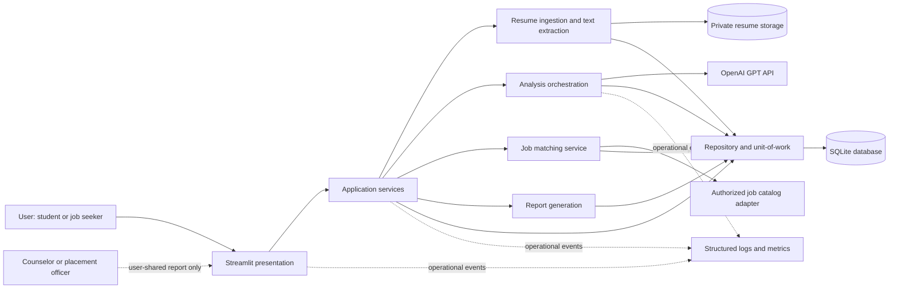
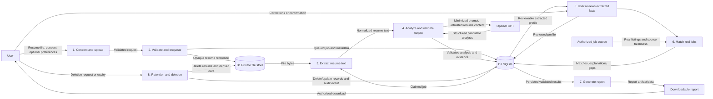

# AI Resume Analyzer — Production Architecture

**Status:** Proposed  
**Architecture style:** Modular monolith with asynchronous analysis jobs  
**Primary stack:** Streamlit, Python, OpenAI GPT, SQLite, pytest

This architecture implements the resume-analysis and job-discovery experience described in [PRD.md](./PRD.md). It treats AI output as advisory, keeps the user's resume private by default, and does not use the system to make hiring decisions.

## 1. High-Level Architecture

### 1.1 Logical view



### 1.2 Runtime and deployment shape

- **Streamlit process:** Renders the UI and handles authenticated or session-scoped user actions. It calls application services, not SQL or OpenAI directly.
- **Analysis worker:** Processes persisted analysis jobs using the same Python application package. The worker is bounded by configured concurrency and uses short database transactions.
- **SQLite:** Stores job state, user/session references, extracted and analyzed results, job catalog cache metadata, and audit events that do not contain resume text. Use a local persistent disk, not a network filesystem.
- **Private file storage:** Holds uploaded resume bytes outside the web root, with generated opaque identifiers, strict file permissions, encryption at rest, and retention-based deletion. Keep the original file only as long as needed and as disclosed to the user.
- **OpenAI API:** Called only from backend services over TLS. The API key is supplied through a secret manager/environment configuration, never the browser or source control. Confirm provider data handling and retention terms before launch.
- **Job catalog adapter:** Connects to an authorized, current data source. If no suitable source is configured or the source fails, return an explicit unavailable state instead of inventing job records.
- **Operations:** Emit privacy-safe structured logs, metrics, and health signals. Do not log resumes, extracted text, prompts containing personal information, API keys, or full model responses.

### 1.3 Analysis lifecycle

1. User sees accepted file types, size limits, privacy/retention information, and required consent before upload.
2. The UI validates basic upload constraints and asks the application service to accept the file.
3. The service validates file signature and content, assigns an opaque resume ID, stores the file privately, and persists an analysis job as `queued`.
4. A worker claims the job, extracts text, and stores only the minimum information required for processing and the report.
5. The analysis service sends a bounded, minimized prompt to GPT and validates the response against a strict schema. Resume content is untrusted input, not instructions.
6. The user reviews extracted facts and corrects material errors before relying on findings or requesting recommendations.
7. The job matching service compares reviewed skills and user-selected preferences with real job records and returns evidence-based explanations.
8. The report service creates a downloadable report for the authorized user. The UI shows `completed` only after report data is persisted successfully.
9. Data-retention/deletion processing removes the source file and related derived data according to the disclosed policy. The user is told when deletion cannot be immediate or is subject to a legal hold.

### 1.4 SQLite operating boundary

SQLite is appropriate for a pilot or modest, single-host deployment when operational simplicity is important. It is not a shared, multi-host database. Use WAL mode where appropriate, foreign keys, busy timeouts, schema migrations, backups, and one connection per thread/process. Keep transactions short and never hold a write transaction open while calling GPT or a job provider.

Because SQLite serializes writes, cap worker concurrency and test lock contention under expected load. Keep the database and WAL files on the same persistent local disk. Define tested backup/restore and deletion procedures. If sustained write contention, multiple application replicas, or high availability across hosts becomes a requirement, migrate to a server database and durable queue; do not place SQLite on shared network storage.

## 2. Component Diagram

```mermaid
flowchart TB
    subgraph Presentation
        Streamlit[Streamlit pages and widgets]
        Session[Session state and interaction state]
    end
    subgraph Application["Application layer — use cases"]
        Submit[SubmitResume]
        Status[GetAnalysisStatus]
        Review[ReviewExtractedProfile]
        Analyze[RunAnalysisJob]
        Recommend[RecommendJobs]
        Download[DownloadReport]
        Delete[DeleteUserData]
    end
    subgraph Domain["Domain layer — framework independent"]
        ResumeModel[Resume and extracted profile]
        AnalysisModel[Analysis result and evidence]
        JobModel[Job, match, and skill gap]
        Policies[Validation, retention, and matching policies]
    end
    subgraph Adapters["Adapters and infrastructure"]
        Parser[PDF/DOCX text extractor]
        AI[OpenAI client adapter]
        Catalog[Job catalog adapter]
        Renderer[Report renderer]
        SQLiteRepo[SQLite repositories]
        BlobStore[Private file store]
        Worker[Job runner]
        Migrations[Schema migrations]
    end

    Streamlit --> Session
    Streamlit --> Submit
    Streamlit --> Status
    Streamlit --> Review
    Streamlit --> Recommend
    Streamlit --> Download
    Streamlit --> Delete
    Worker --> Analyze
    Submit --> Policies
    Analyze --> Parser
    Analyze --> AI
    Recommend --> Catalog
    Download --> Renderer
    Submit --> SQLiteRepo
    Status --> SQLiteRepo
    Review --> SQLiteRepo
    Analyze --> SQLiteRepo
    Recommend --> SQLiteRepo
    Download --> SQLiteRepo
    Delete --> SQLiteRepo
    Submit --> BlobStore
    Delete --> BlobStore
    SQLiteRepo --> Migrations
    Submit --> ResumeModel
    Analyze --> AnalysisModel
    Recommend --> JobModel
```



### Component responsibilities

| Component | Responsibility |
|---|---|
| Streamlit presentation | Upload, consent, processing status, review/edit extracted facts, analysis display, recommendation display, and report download. No business rules or direct infrastructure access. |
| Application use cases | Coordinate workflows, enforce authorization and state transitions, define transaction boundaries, and translate expected failures into typed application errors. |
| Domain | Typed entities/value objects and deterministic policies for validation, evidence, skill gaps, match explanations, and retention. No Streamlit, SQLite, or OpenAI imports. |
| Resume extractor | Safely parse explicitly supported formats, enforce page/size limits, and return normalized text plus extraction metadata. |
| OpenAI adapter | Configure timeouts/retries, send minimized inputs, request schema-constrained output, validate the response, and map provider failures to typed errors. |
| Job catalog adapter | Fetch/cache authorized listings, validate freshness and fields, and return source metadata. |
| Repositories | Persist domain objects and job state through parameterized SQL and explicit transactions. |
| Private file store | Store and delete original uploaded files without serving them as public static assets. |
| Worker | Claim queued work, apply bounded concurrency, persist terminal status, and recover or mark jobs that exceed the lease/timeout. |
| Report renderer | Render a deterministic, safe, accessible downloadable report from persisted validated data. |

## 3. Data Flow Diagram



### Data handling rules

- Treat uploaded files and extracted text as sensitive personal data and untrusted input.
- Keep raw text out of ordinary logs, analytics, error messages, and SQLite records unless a documented, consented requirement justifies retention.
- Persist only the minimum required result fields. Use an explicit retention schedule for original files, extracted text, analysis results, and reports.
- Use opaque identifiers rather than file names as storage paths. Sanitize filenames for display and never use them to construct paths.
- Make report access user-scoped and time-limited where reports are delivered through a link. Do not expose reports by guessable IDs.
- Maintain data provenance: record model/configuration version and analysis time, and attach evidence references where practical without unnecessarily duplicating resume content.

## 4. Recommended Folder Structure

```text
ai_resume_analyzer/
├── pyproject.toml
├── README.md
├── .env.example
├── .gitignore
├── alembic.ini                 # If Alembic is selected for SQLite migrations
├── src/
│   └── resume_analyzer/
│       ├── __init__.py
│       ├── py              # Streamlit entry point
│       ├── config.py           # Validated settings; no secrets committed
│       ├── ui/
│       │   ├── pages/
│       │   ├── components/
│       │   └── session.py
│       ├── domain/
│       │   ├── entities.py
│       │   ├── value_objects.py
│       │   ├── policies.py
│       │   └── errors.py
│       ├── application/
│       │   ├── ports.py        # Protocols for repositories and providers
│       │   ├── dto.py
│       │   └── use_cases/
│       ├── infrastructure/
│       │   ├── db/
│       │   │   ├── connection.py
│       │   │   ├── repositories.py
│       │   │   └── migrations/
│       │   ├── storage/
│       │   │   └── local_file_store.py
│       │   ├── resume/
│       │   │   └── extractors/
│       │   ├── ai/
│       │   │   └── openai_adapter.py
│       │   ├── jobs/
│       │   │   └── catalog_adapter.py
│       │   ├── reports/
│       │   │   └── renderer.py
│       │   └── logging.py
│       └── worker.py
├── tests/
│   ├── unit/
│   ├── integration/
│   ├── contract/
│   ├── security/
│   ├── fixtures/
│   └── conftest.py
└── var/                        # Runtime data only; excluded from source control
    ├── sqlite3
    └── resumes/
```

The package layout is a recommendation, not a requirement to split every module immediately. Keep runtime data, secrets, generated reports, and uploaded resumes outside the source tree and version control. Use an explicit migration tool or versioned SQL migrations before schema changes reach production.

## 5. Design Patterns

1. **Layered architecture / modular monolith:** Keep UI, application use cases, domain rules, and infrastructure separate while shipping one cohesive Python application.
2. **Ports and adapters (hexagonal):** Define Python `Protocol` interfaces for repositories, resume extraction, AI completion, job catalog, and report rendering. Inject concrete adapters so domain/application tests do not call external services.
3. **Use-case / service layer:** Model workflows such as `SubmitResume`, `RunAnalysis`, `ReviewProfile`, `RecommendJobs`, and `DeleteUserData` explicitly. This centralizes authorization and state transitions.
4. **Repository and Unit of Work:** Encapsulate parameterized SQLite queries and commit/rollback behavior. Keep transactions short; do not hold a transaction across external API calls.
5. **Strategy:** Select supported resume extractors and job-matching strategies behind stable interfaces; unsupported formats fail explicitly.
6. **State machine:** Persist analysis states (`queued`, `processing`, `awaiting_review`, `completed`, `failed`, `cancelled`) and validate legal transitions. Store stable machine-readable error codes separately from user-safe messages.
7. **Adapter plus anti-corruption boundary:** Normalize provider-specific GPT and job-catalog responses into internal domain types; do not leak vendor schemas into UI or business logic.
8. **Idempotent job processing:** Give each submitted analysis a stable job ID and guard state transitions so retries do not create duplicate analyses or reports.

## 6. Security Considerations

### Identity, authorization, and secrets

- Decide and implement the launch identity model (institutional SSO, account login, or a clearly limited single-user pilot) before exposing the service to multiple users. A random session ID alone is not authentication.
- Enforce authorization in application use cases for every resume, analysis, deletion, and report request; do not rely only on hiding UI controls.
- Store OpenAI and other provider credentials in a secret manager or deployment environment. Never put keys in Streamlit client state, logs, repository files, or downloadable reports.
- Require TLS at the ingress, set secure cookie/session behavior through the deployment proxy, and apply least-privilege OS and database file permissions.

### File and prompt safety

- Allowlist formats and verify file signatures rather than trusting extensions or browser MIME types. Apply byte, page, and extracted-text limits; reject encrypted or malformed documents with a specific user-safe error.
- Parse files in a constrained process where practical; keep parser libraries patched. Do not execute macros, embedded files, links, or other active content.
- Generate storage names server-side, prevent path traversal, and store files outside the web root. Encrypt persistent storage and backups; restrict access to the service account.
- Treat resume text as untrusted data. Delimit it as data in prompts, instruct the model to ignore instructions embedded in the resume, and never allow model output to invoke tools or perform privileged actions.
- Require structured output with strict schema and length bounds. Validate all fields, escape rendered content, and reject unsupported output rather than displaying arbitrary HTML or Markdown unsafely.
- Minimize personal data sent to the model and confirm provider retention, training-use, regional processing, and contractual terms before production.

### Data, application, and operational safeguards

- Use parameterized SQL, foreign-key constraints, least-privilege access, secure migration practices, and tested restore procedures. Do not expose the SQLite file through static hosting.
- Protect report downloads with user authorization and expiring tokens if links are used. Apply CSRF/session protections appropriate to the hosting setup and rate-limit uploads and analysis requests.
- Define retention and deletion for source files, extracted text, results, backups, and provider-side data. A deletion request must remove the source and derived user data within the documented service level.
- Avoid sensitive attributes and proxies in job ranking. Do not present AI findings as objective candidate scores or as hiring recommendations.
- Audit administrative access and data deletion using minimal metadata. Restrict and review access to audit events.
- Establish dependency scanning, secret scanning, patching, incident response, and a documented privacy/security review before release.

## 7. Logging and Observability Strategy

- Use Python's standard `logging` with structured JSON output in production; use readable console output locally. Include timestamp, severity, service/environment, event name, trace/request ID, analysis/job ID, and duration.
- Log lifecycle events such as upload accepted/rejected, job queued/started/completed/failed, provider latency/failure class, report generated/downloaded, and data deletion completed.
- Do **not** log resume bytes/text, extracted personal details, prompts, full GPT responses, access tokens, API keys, or raw exception context that can contain user data.
- Redact sensitive values at the logging boundary. Keep user-facing errors separate from internal diagnostic details.
- Track metrics: upload validation failures by reason, analysis queue depth and age, end-to-end latency, GPT latency/error/timeout rates, token/cost estimates without content, report generation success, SQLite busy/locked errors, and deletion completion.
- Add health checks for application readiness, database connectivity, worker liveness, and external-provider availability without exposing internals. Alert on sustained queue age, elevated failure rates, database lock contention, storage capacity, and backup failures.
- Define log retention and access controls. Use correlation IDs to trace a workflow across UI and worker without using a user's email or resume content as an identifier.

## 8. Error Handling Strategy

### Error taxonomy

| Category | Examples | Handling |
|---|---|---|
| User-correctable input | Unsupported file type, file too large, unreadable document, missing consent | Return a typed validation error with a safe, actionable explanation. Do not enqueue work. |
| Transient dependency | GPT timeout/rate limit, job catalog timeout, temporary storage issue | Apply bounded retries with exponential backoff and jitter where the operation is safe; preserve job state and show processing/retry status. |
| Permanent dependency/configuration | Invalid API key, unsupported provider response, unavailable job source configuration | Fail visibly, record a sanitized diagnostic event, and provide a support-oriented message. Do not fabricate a successful analysis or job result. |
| Data/invariant | Illegal state transition, invalid model schema, missing record | Roll back the relevant transaction, preserve a stable error code, and alert on unexpected invariant violations. |
| Internal/unexpected | Unhandled exception | Catch only at application/worker boundaries, log a redacted traceback with correlation ID, mark the job failed when possible, and show a generic error plus retry/support guidance. |

### Operational rules

- Define typed exceptions at infrastructure boundaries and translate them into a small set of application-level errors. Avoid broad catches inside domain logic.
- Apply explicit connect/read timeouts and bounded retry counts to GPT and job-source calls. Retry only transient failures; do not retry validation, authentication, or schema errors blindly.
- Use a persisted job lease/heartbeat or equivalent so a worker crash does not leave work indefinitely in `processing`. A recovery process can requeue expired leases or mark them failed after a bounded number of attempts.
- Keep external calls outside database transactions. Persist each state transition atomically and use idempotency keys to protect retries.
- Show safe, specific user messages; retain detailed diagnostics only in access-controlled logs. Never mark a job complete or offer a download if required result persistence failed.
- Make partial availability explicit: a valid resume analysis may be available while job recommendations are marked unavailable, but the report must accurately state that condition.

## 9. Testing Strategy

Use pytest with fast deterministic unit tests as the foundation. Inject fakes for the OpenAI client, job catalog, repositories, clock, and file store; tests must not require live credentials or send real resumes to third parties.

| Test layer | Focus | Examples |
|---|---|---|
| Unit | Domain policies and individual use cases with fakes | State transitions, retention rules, evidence wording, skill gaps, matching explanations, output schema validation, retry classification. |
| Parser/security | File validation and hostile inputs | MIME/signature mismatch, oversized and malformed files, path traversal names, prompt injection text, HTML/script in model output, parser limits. |
| Integration | Real SQLite in a temporary directory and local fake adapters | Migrations, repository CRUD, foreign keys, transaction rollback, job claiming/idempotency, concurrent access and lock timeout behavior. |
| Contract | External adapter request/response contracts | GPT structured-output schema, provider error mapping, job source freshness and required fields. Use recorded sanitized fixtures; never store real personal data. |
| UI/workflow | Streamlit interaction flows | Consent before processing, upload errors, review/correction, unavailable job catalog, safe report download, deletion confirmation. |
| End-to-end | Deployed-like single-host workflow | Submit fixture resume, poll job, review results, generate report, delete data. Use a fake GPT endpoint in CI and a separately gated provider smoke test if needed. |
| Quality and fairness | Representative synthetic or consented, de-identified data | Extraction and recommendation quality across file layouts, early-career profiles, and demographic fairness review under a documented protocol. |
| Resilience/performance | Load and failure conditions | GPT latency/timeouts, worker restart, queue backlog, SQLite contention, p95 analysis time and report reliability against agreed targets. |

### Test and release gates

- Require unit, integration, security-focused, and lint/type checks in CI; block release on failures.
- Test schema migrations both from an empty database and from the prior supported version, including backup/restore.
- Set explicit quality thresholds for parsing, structured-output validity, job-source freshness, and workflow completion before pilot; do not use a single model-quality score as a release gate.
- Run a privacy review and verify that logs, reports, backups, and deletion flows do not expose unauthorized resume data.
- Use synthetic resumes by default in tests. Any real-data evaluation requires consent, access restrictions, minimization, and a documented deletion plan.
- Validate the PRD's measurable service targets under representative pilot load, including report success and p95 processing latency.

## 10. Architecture Decisions to Confirm Before Implementation

1. Supported upload formats, maximum file size/pages, and whether scanned PDFs are in the first release.
2. Identity and user authorization approach for a multi-user deployment.
3. Hosting topology and expected concurrency; confirm SQLite is acceptable for the single-host operating boundary.
4. Resume and derived-data retention period, deletion service level, backup retention, and provider-side data terms.
5. Authorized job data source, freshness SLA, and whether recommendations are in the first deployable milestone.
6. Report format (HTML, PDF, or both) and whether reports are stored or generated on demand.
7. Required jurisdictions, accessibility conformance, and legal/privacy review owners.
