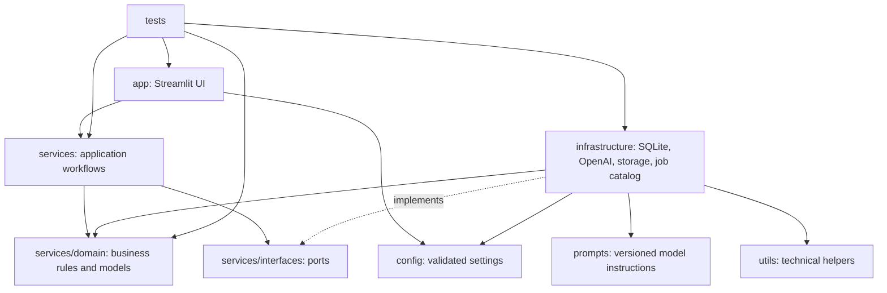

# AI Resume Analyzer — Python Project Structure

**Architecture style:** Modular monolith with ports-and-adapters boundaries  
**Stack:** Streamlit, Python, OpenAI GPT, SQLite, pytest

This structure separates the Streamlit interface, application workflows, domain rules, and external integrations. It is designed for a single deployable application that can be split into services later if traffic or operational needs justify it. The system provides career guidance; it must not make hiring decisions or present AI output as verified fact.

## 1. Folder Structure

```text
ai-resume-analyzer/
├── pyproject.toml
├── README.md
├── .env.example
├── .gitignore
├── .pre-commit-config.yaml
├── alembic.ini
├── config/
│   ├── __init__.py
│   ├── settings.py
│   └── logging.yaml
├── app/
│   ├── __init__.py
│   ├── main.py
│   ├── container.py
│   ├── pages/
│   │   ├── __init__.py
│   │   ├── upload.py
│   │   ├── analysis.py
│   │   └── report.py
│   ├── components/
│   │   ├── __init__.py
│   │   ├── consent.py
│   │   ├── status.py
│   │   └── feedback.py
│   └── state.py
├── services/
│   ├── __init__.py
│   ├── interfaces.py
│   ├── schemas.py
│   ├── exceptions.py
│   ├── resume_service.py
│   ├── analysis_service.py
│   ├── recommendation_service.py
│   ├── report_service.py
│   ├── deletion_service.py
│   ├── worker.py
│   ├── domain/
│   │   ├── __init__.py
│   │   ├── models.py
│   │   ├── policies.py
│   │   └── states.py
│   └── repositories/
│       ├── __init__.py
│       ├── resume_repository.py
│       ├── analysis_repository.py
│       └── job_repository.py
├── prompts/
│   ├── __init__.py
│   ├── resume_analysis.py
│   └── job_matching.py
├── utils/
│   ├── __init__.py
│   ├── file_validation.py
│   ├── text_extraction.py
│   ├── database.py
│   ├── logging.py
│   └── report_rendering.py
├── infrastructure/
│   ├── __init__.py
│   ├── ai/
│   │   ├── __init__.py
│   │   └── openai_client.py
│   ├── storage/
│   │   ├── __init__.py
│   │   └── local_file_store.py
│   ├── jobs/
│   │   ├── __init__.py
│   │   └── catalog_client.py
│   └── db/
│       ├── __init__.py
│       ├── sqlite_repositories.py
│       └── migrations/
│           └── versions/
├── tests/
│   ├── conftest.py
│   ├── unit/
│   │   ├── test_policies.py
│   │   ├── test_resume_service.py
│   │   ├── test_analysis_service.py
│   │   └── test_recommendation_service.py
│   ├── integration/
│   │   ├── test_sqlite_repositories.py
│   │   └── test_analysis_workflow.py
│   ├── contract/
│   │   ├── test_openai_schema.py
│   │   └── test_job_catalog_schema.py
│   ├── security/
│   │   ├── test_upload_validation.py
│   │   └── test_output_sanitization.py
│   └── fixtures/
│       └── resumes/
├── scripts/
│   ├── run_worker.py
│   └── backup_database.py
└── var/                         # Local runtime data; never commit
    ├── sqlite3
    └── resumes/
```

`var/` is a runtime location, not a required tracked directory; production paths should be configured to persistent private storage. Do not commit uploaded resumes, generated reports, databases, credentials, or real personal data.

## 2. Files and Responsibilities

### Root and configuration

| File/folder | Purpose and responsibility |
|---|---|
| `pyproject.toml` | Declares runtime and development dependencies, package metadata, pytest settings, and formatter/linter/type-checker configuration. Pin or constrain versions according to the release policy. |
| `README.md` | Documents setup, configuration, local execution, migrations, tests, and deployment commands. |
| `.env.example` | Lists configuration variable names and safe placeholders only. Never put real credentials here. |
| `.gitignore` | Excludes secrets, virtual environments, caches, databases, resume files, reports, and generated artifacts. |
| `.pre-commit-config.yaml` | Runs formatting, linting, and secret checks before commits. |
| `alembic.ini` | Configures Alembic if that migration tool is selected; migrations are required for production schema changes. |
| `config/settings.py` | Loads and validates typed settings at process startup, including database path, storage path, file limits, provider timeouts, and feature flags. Fails fast on missing required configuration. |
| `config/logging.yaml` | Defines environment-appropriate structured logging. Redaction and privacy rules must also be enforced at the logging code boundary. |

### `app/` — Streamlit presentation

| File | Responsibility |
|---|---|
| `app/main.py` | Streamlit entry point; configures the page and navigation, initializes dependencies, and invokes page rendering. Keep it thin. |
| `app/container.py` | Composition root that constructs repositories, adapters, and application services from validated settings. |
| `app/state.py` | Small helpers for Streamlit interaction state (for example, current analysis ID and review progress). Never treat session state as authorization or durable storage. |
| `app/pages/upload.py` | Upload and consent experience; displays allowed formats/limits and calls the resume submission use case. |
| `app/pages/analysis.py` | Shows processing state, reviewable extracted facts, analysis findings, and user corrections by calling application services. |
| `app/pages/report.py` | Requests an authorized report and presents download controls and safe failure/retry messages. |
| `app/components/consent.py` | Reusable privacy and consent display with explicit user action before processing. |
| `app/components/status.py` | Reusable progress and status presentation mapped from application job states. |
| `app/components/feedback.py` | Captures optional user feedback without storing resume content in analytics. |

UI modules may depend on `services` interfaces/use cases and validated presentation schemas. They must not contain SQL, call OpenAI directly, parse uploaded documents, or make access-control decisions solely by hiding controls.

### `services/` — Application workflows and domain

| File/folder | Responsibility |
|---|---|
| `services/interfaces.py` | Defines Python `Protocol` ports for repositories, AI completion, file storage, resume extraction, job catalog, and report rendering. Application logic depends on these abstractions. |
| `services/schemas.py` | Defines validated input/output DTOs shared at application boundaries, including strict AI response shapes. Keep provider-specific wire models in the adapter when they differ. |
| `services/exceptions.py` | Declares typed application errors such as invalid upload, analysis unavailable, forbidden access, and report generation failure. |
| `services/resume_service.py` | Coordinates consent check, upload validation, private file storage, and creation of a queued analysis record. |
| `services/analysis_service.py` | Orchestrates extraction and analysis, validates model output, persists results and provenance, and enforces legal state transitions. |
| `services/recommendation_service.py` | Compares reviewed user skills/preferences with real job listings and produces explainable matches and skill gaps. No fabricated fallback jobs. |
| `services/report_service.py` | Authorizes report access, assembles persisted result data, and invokes a renderer. |
| `services/deletion_service.py` | Deletes source files and associated derived data under the configured retention/deletion policy; records minimal audit metadata. |
| `services/worker.py` | Claims queued analysis jobs, executes bounded work, updates status, and handles retries/expired leases. External calls occur outside database transactions. |
| `services/domain/models.py` | Framework-independent domain entities/value objects such as Resume, ExtractedProfile, AnalysisResult, JobListing, and MatchExplanation. |
| `services/domain/policies.py` | Deterministic business policies for evidence labels, skill-gap wording, retention eligibility, and recommendation constraints. |
| `services/domain/states.py` | Job state enumeration and allowed state transitions, such as queued → processing → awaiting_review/completed/failed. |
| `services/repositories/*.py` | Repository interfaces or application-facing persistence contracts, separated by aggregate where useful. Concrete SQLite implementation belongs in `infrastructure/db/`. |

Keep the domain independent of Streamlit, SQLite, OpenAI SDKs, and file-parsing libraries. Use cases own workflow orchestration and authorization checks, not the UI.

### `prompts/` — Versioned model instructions

| File | Responsibility |
|---|---|
| `prompts/resume_analysis.py` | Holds versioned system/task instructions for structured resume analysis. Treat resume content as untrusted data; prohibit invented claims and ask for evidence/uncertainty. |
| `prompts/job_matching.py` | Holds instructions for explaining matches using supplied, real job records and user-approved preferences. It must not generate listings or infer protected traits. |

Prompts are part of the application behavior: review changes, test their output schema and safety constraints, and record prompt version with analysis metadata. Do not include secrets or raw personal data in prompt source files.

### `utils/` — Small, reusable technical helpers

| File | Responsibility |
|---|---|
| `utils/file_validation.py` | Implements deterministic type/signature/size validation helpers used by the ingestion path. |
| `utils/text_extraction.py` | Provides low-level format-specific extraction helpers with page, size, and time bounds; application orchestration remains in the service. |
| `utils/database.py` | Creates configured SQLite connections, enables foreign keys and busy timeout, and applies supported pragmas. Connection lifecycle and transactions must be explicit. |
| `utils/logging.py` | Configures structured logging and redaction for sensitive fields. Never log resume text, prompts, credentials, or full model responses. |
| `utils/report_rendering.py` | Low-level report formatting/escaping utilities. The report use case and authorization remain in `services/report_service.py`. |

Utilities should remain small and stateless where possible. A helper that encodes a business decision belongs in `services/domain/policies.py`, not in `utils/`.

### `infrastructure/` — External integrations and implementations

| File/folder | Responsibility |
|---|---|
| `infrastructure/ai/openai_client.py` | Implements the AI port using the OpenAI SDK, with explicit timeouts, bounded transient retries, schema validation, token/cost metadata, and sanitized provider error mapping. |
| `infrastructure/storage/local_file_store.py` | Implements private local file storage using opaque server-generated IDs, safe paths, restrictive permissions, and deletion. Replaceable with object storage without changing use cases. |
| `infrastructure/jobs/catalog_client.py` | Implements the authorized job source adapter, normalizes listings, and communicates freshness/unavailability explicitly. |
| `infrastructure/db/sqlite_repositories.py` | Implements repository ports with parameterized SQL and short transactions against SQLite. |
| `infrastructure/db/migrations/versions/` | Versioned schema migrations, including indexes, constraints, and safe upgrade paths. |
| `scripts/run_worker.py` | Starts the worker process with production configuration and graceful shutdown. |
| `scripts/backup_database.py` | Performs a documented, consistent SQLite backup and reports failures; restoration must be separately tested. |

### `tests/` — Quality gates

| Folder/file | Responsibility |
|---|---|
| `tests/conftest.py` | Shared pytest fixtures: temporary SQLite database, fake AI/catalog clients, fake file storage, deterministic clock, and synthetic resumes. |
| `tests/unit/` | Fast tests for domain policies and use cases with fakes; no live OpenAI calls or persistent user data. |
| `tests/integration/` | Tests concrete SQLite repositories, migrations, transactions, and complete application workflows using temporary files. |
| `tests/contract/` | Verifies internal schemas against sanitized provider/job-source fixtures and expected adapter behavior. |
| `tests/security/` | Tests malformed uploads, path traversal, prompt injection handling, unsafe model output, authorization boundaries, and sensitive-data redaction. |
| `tests/fixtures/resumes/` | Synthetic, non-identifying sample files only. Keep real resumes out of source control and CI fixtures. |

## 3. Dependency Relationships

### Dependency direction



**Rules of dependency:**

1. `app/` calls application use cases and formats results for Streamlit; it does not import concrete SQLite or OpenAI implementations.
2. `services/` owns workflow logic and depends on domain types and protocol interfaces. It must not import Streamlit or vendor SDKs.
3. `services/domain/` is the most stable layer and must not depend on other project layers or external services.
4. `infrastructure/` implements the ports defined by the application and may depend on vendor libraries, prompts, and low-level utilities.
5. `config/` supplies validated settings to the composition root; modules should not read environment variables ad hoc.
6. `prompts/` are consumed only through the AI adapter/use case boundary; UI code must not construct prompts.
7. `utils/` must not import `app/` or `services/` to avoid circular dependencies. Keep business policies out of utilities.
8. `tests/` may depend on any production layer, but production code must never import `tests/`.
9. Avoid circular imports. Construct concrete dependencies once in `app/container.py` and inject them into use cases.

### Example request path

`app/pages/upload.py` → `services/resume_service.py` → protocol in `services/interfaces.py` → `infrastructure/storage/local_file_store.py` and `infrastructure/db/sqlite_repositories.py`.

Analysis follows `services/worker.py` → `services/analysis_service.py` → extraction and AI ports → concrete parser and `infrastructure/ai/openai_client.py`; results return through repository ports. GPT calls never originate in a Streamlit page.

## 4. Scalability and Maintainability Notes

- Start as a modular monolith. Keep clear interfaces so file storage, job catalogs, or SQLite can be replaced independently if growth demands it.
- SQLite is a single-host choice, not a multi-replica database. Use short transactions, bounded worker concurrency, WAL where appropriate, busy timeouts, migrations, and tested backups. Move to a server database and durable queue if concurrency or availability needs exceed SQLite's operating boundary.
- Keep analysis asynchronous once request duration or provider latency makes synchronous UI requests unreliable. Persist job status and let Streamlit poll or refresh it.
- Make analysis jobs idempotent and attach schema/model/prompt versions to results to support reproducibility and controlled upgrades.
- Separate configuration from code; fail fast for invalid production settings; never provide production-shaped fallback behavior when an integration is unavailable.
- Establish lint, type-check, migration, pytest, dependency, and secret-scanning checks in CI. Use synthetic test data and fakes in ordinary CI.

## 5. Suggested Test Commands

```powershell
python -m pytest
python -m pytest tests\unit
python -m pytest tests\integration
```

Add the selected formatter, linter, and type checker to `pyproject.toml`; use the repository's configured commands consistently in local development and CI.
