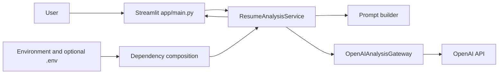

# AI Resume Analyzer

A Streamlit application that analyzes pasted resume text using OpenAI GPT and
returns structured career feedback. The project uses Python services with
validated configuration, a provider adapter, and offline pytest coverage.

> **Important:** Analysis is AI-generated career guidance, not verified fact,
> hiring advice, or a guarantee of employment. The application suggests role
> types; it does not search a live job feed or provide verified job vacancies.

## Contents

- [Overview](#overview)
- [Features](#features)
- [Architecture](#architecture)
- [Installation](#installation)
- [Setup](#setup)
- [Environment variables](#environment-variables)
- [Running the application](#running-the-application)
- [Running tests](#running-tests)
- [Troubleshooting](#troubleshooting)
- [Security guidelines](#security-guidelines)
- [Future enhancements](#future-enhancements)

## Overview

Users paste resume text into the Streamlit interface, review the data-processing
notice, and submit it for analysis. The service validates the input length,
builds a prompt that treats resume text as untrusted data, calls the configured
OpenAI model, validates the JSON response, and displays the result.

The analysis includes:

- Resume summary
- Technical skills
- Soft skills
- Experience assessment
- Suggested job roles
- Skills not evidenced in the resume
- Learning suggestions
- Resume improvements

The current version keeps successful results in the active Streamlit session
and clears them when the resume text changes. It does not provide durable
analysis history.

## Features

- Paste resume text in the browser.
- Require the user to confirm that text will be sent to the configured AI
  provider.
- Enforce a configurable maximum resume length.
- Request structured JSON and validate required fields, types, and output
  limits before displaying results.
- Present model findings as plain text rather than rendering arbitrary model
  output as HTML or Markdown.
- Handle configuration, input, provider, malformed-response, and unexpected
  errors with user-safe messages.
- Cache the OpenAI client and analysis service for the Streamlit process.
- Run unit, integration, negative, and configuration tests offline with a
  mocked provider; tests do not require an API key or internet access.

## Architecture

The application is a small modular Python application, not yet the broader
asynchronous, SQLite-backed architecture described in [ARCHITECTURE.md](./ARCHITECTURE.md).



### Main modules

| Path | Responsibility |
|---|---|
| `app/main.py` | Streamlit page, consent interaction, and user-facing error handling. |
| `app/config/settings.py` | Reads and validates environment-based settings. |
| `app/container.py` | Creates and caches process-level OpenAI and service dependencies. |
| `app/infrastructure/openai_gateway.py` | Adapts OpenAI chat completions to the application gateway contract. |
| `app/services/resume_service.py` | Validates resume input and the structured analysis response. |
| `app/prompts/resume_prompt.py` | Defines system instructions and safely encodes resume text in the user prompt. |
| `app/presentation.py` | Renders analysis fields in the Streamlit UI. |
| `app/utils/logging_config.py` | Configures logging and emits redacted diagnostics for unexpected failures. |
| `tests/` | Offline unit, integration, validation, and UI tests. |

## Installation

### Prerequisites

- Python 3.10 or later. Python 3.12 is used for current local validation.
- `pip`
- An OpenAI API key for live analysis. An API key is **not** needed to run tests.

### Windows (PowerShell)

From the project root:

```powershell
py -3 -m venv .venv
.\.venv\Scripts\Activate.ps1
python -m pip install --upgrade pip
python -m pip install -r requirements-dev.txt
```

If PowerShell prevents activation, either adjust the policy for your user
according to your organization’s guidance, or use the environment's executable
directly:

```powershell
.\.venv\Scripts\python.exe -m pip install -r requirements-dev.txt
```

### Linux

Install Python 3, `venv`, and pip using your distribution's package manager if
they are not already installed. Then, from the project root:

```bash
python3 -m venv .venv
source .venv/bin/activate
python -m pip install --upgrade pip
python -m pip install -r requirements-dev.txt
```

### macOS

Install Python 3 using your preferred trusted distribution (for example,
python.org or Homebrew). Then, from the project root:

```bash
python3 -m venv .venv
source .venv/bin/activate
python -m pip install --upgrade pip
python -m pip install -r requirements-dev.txt
```

## Setup

Create a local `.env` file from the example template.

### Windows (PowerShell)

```powershell
Copy-Item .env.example .env
notepad .env
```

### Linux and macOS

```bash
cp .env.example .env
${EDITOR:-vi} .env
```

Set `OPENAI_API_KEY` to a valid secret in `.env`, or set it in the process
environment using the instructions below. Do not paste real credentials into
source files, documentation, issue trackers, or chat.

### Set the key in the current shell (optional)

PowerShell:

```powershell
$env:OPENAI_API_KEY = "your-provider-key"
```

Linux or macOS shell:

```bash
export OPENAI_API_KEY="your-provider-key"
```

When both the environment and `.env` define a variable, existing environment
values take precedence under the default `python-dotenv` behavior.

## Environment variables

| Variable | Required | Default | Description |
|---|---:|---|---|
| `OPENAI_API_KEY` | Yes for running the app | None | Secret credential used by the backend OpenAI client. Never expose it to browser code or commit it. |
| `OPENAI_MODEL` | No | `gpt-4o-mini` | Model name sent to the OpenAI chat completions API. |
| `OPENAI_TIMEOUT_SECONDS` | No | `45` | Finite positive provider request timeout in seconds. |
| `MAX_RESUME_CHARACTERS` | No | `30000` | Positive maximum number of resume characters accepted by the UI and service. |

Configuration is loaded by `Settings.from_env()` and invalid or missing required
settings are reported rather than silently replaced with a success-shaped
fallback.

## Running the application

Activate the virtual environment created during installation, then run:

Windows (PowerShell):

```powershell
streamlit run app\main.py
```

Linux or macOS:

```bash
streamlit run app/main.py
```

Streamlit prints a local URL, usually `http://localhost:8501`. Open it in a
browser, paste resume text, confirm the processing notice, and select **Analyze
Resume**.

The OpenAI client and service are cached for the running process. Restart the
application after changing the key, model, or timeout. Resume analysis is
synchronous in this version, so the page waits for the provider response.

## Running tests

The tests use fake gateways and mocked OpenAI-shaped responses. They do not
create a real OpenAI client, require a valid key, or make network requests.

Windows:

```powershell
python -m pytest -q
```

Linux or macOS:

```bash
python -m pytest -q
```

To run specific test groups:

```bash
python -m pytest tests/test_settings.py tests/test_resume_service.py -q
python -m pytest tests/test_resume_analysis_integration.py tests/test_openai_gateway.py -q
python -m pytest tests/test_app_flow.py -q
```

If the virtual environment is not activated on Windows, use
`.\.venv\Scripts\python.exe -m pytest -q`; on Linux or macOS use
`./.venv/bin/python -m pytest -q`.

## Troubleshooting

### Application says `OPENAI_API_KEY` is required

- Confirm `.env` exists at the project root, or set the variable in the current
  shell.
- Check the variable spelling and ensure the value is not blank.
- Restart Streamlit after changing configuration.
- Do not include extra quotes as part of the key value unless your shell or
  dotenv syntax requires them.

### OpenAI request fails

- Confirm the key is valid, active, and authorized for the selected model.
- Check provider account access, billing/quota, and service status.
- Check network/proxy settings and increase `OPENAI_TIMEOUT_SECONDS` only when
  slow responses are expected.
- The app intentionally shows a generic provider error; consult protected
  server logs for sanitized diagnostic context. Do not log the resume or key.

### Invalid or incomplete AI response

The service rejects malformed JSON, missing or unexpected fields, invalid
types, oversized values, or empty required text. Retry the request. If it
continues, check whether the selected model supports JSON response mode and
review provider/model compatibility.

### `ModuleNotFoundError` for Streamlit, OpenAI, dotenv, or pytest

Activate the virtual environment and install the declared dependencies:

```bash
python -m pip install -r requirements-dev.txt
```

On Windows PowerShell, if activation is unavailable:

```powershell
.\.venv\Scripts\python.exe -m pip install -r requirements-dev.txt
```

### Resume exceeds the character limit

Shorten the pasted text or set a larger positive `MAX_RESUME_CHARACTERS` value.
Very large prompts may increase cost and latency; raise this limit only with
appropriate provider and deployment safeguards.

### Pylance reports unresolved third-party imports

In VS Code, select the interpreter from this project's `.venv` using **Python:
Select Interpreter**, then reload the window or restart Pylance. Ensure that
interpreter has dependencies installed with `python -m pip install -r
requirements-dev.txt`.

## Security guidelines

- Keep `.env` local and out of version control. The repository's `.gitignore`
  excludes it; verify this before committing.
- `.env.example` must contain placeholders only. Never use a real key in example
  files.
- If a key is committed, exposed, or shared, revoke it with the provider and
  issue a replacement immediately. Removing it from the current file does not
  remove it from repository history, clones, or backups.
- In production, use a secret manager or protected deployment environment
  variables instead of a committed or manually distributed `.env`.
- The application sends pasted resume content to the configured AI provider.
  Review the provider's current data handling terms, retention options, and
  applicable privacy requirements before use with personal data.
- Do not log resume contents, prompts, API credentials, full model responses, or
  unnecessary personal data. Restrict access to diagnostic logs.
- Run behind HTTPS in deployed environments. The application has no built-in
  authentication, authorization, or rate limiting; keep it private until an
  approved identity-aware access layer and usage/cost limits are in place.
- Do not trust identity headers unless they are set by a verified, protected
  proxy and cannot be supplied or overwritten by the client.
- AI output is advisory. Review generated content and do not use it for
  automated hiring or as proof that a person has or lacks a skill.
- Keep dependencies updated and review dependency changes before deployment.

## Future enhancements

Possible next steps, subject to product and operational requirements:

1. Authentication and user-scoped authorization, or a documented protected
   institutional deployment model.
2. Configurable rate limits, request quotas, cost monitoring, and abuse
   detection.
3. Persistent analysis history, explicit deletion, retention controls, and
   downloadable reports.
4. Background analysis jobs with persisted status for long-running provider
   requests.
5. An authorized, current job source with freshness metadata and explainable
   matching; clearly distinguish actual listings from role suggestions.
6. Expanded structured-output quality checks, model/prompt version tracking,
   and representative fairness evaluations.
7. Additional languages, accessible report formats, and broader resume
   document parsing.
8. Reproducible dependency locking and automated CI checks for tests, types,
   lint, secrets, and dependency vulnerabilities.

See [PRD.md](./PRD.md), [ARCHITECTURE.md](./ARCHITECTURE.md), and
[PROJECT_STRUCTURE.md](./PROJECT_STRUCTURE.md) for product requirements,
proposed architecture, and project organization context.
